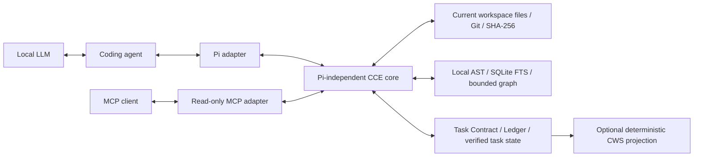

# Architecture

Workspace files are the source of truth. Source hashes detect changes; they do not prove code correctness. Contract revisions require user/host authority. Ledger records provenance and scoped history, not executable instructions. Check receipts are valid only for their bound source state; external edits invalidate prior confirmation.

Pi maps lifecycle events to the core and may deliver bounded recovery after compaction/resume when explicitly enabled. Native fallback and incomplete recovery are distinct outcomes. Durable continuation is explicit and revalidates workspace/checkpoint scope; it does not transplant agent-native history or verified PASS blindly.

CWS derives objective, observations and a recommended next action from existing task state. It creates no third memory store, invokes no background model and has no execution authority. Turn it off independently with `lifecycle.currentWorkEnabled: false`.

Vector retrieval is an optional local adapter, disabled by default. MCP exposes retrieval and logs; it has no Pi compaction hooks. The public package root is the intended API; internal exports exist only to connect alpha adapters and may change.
